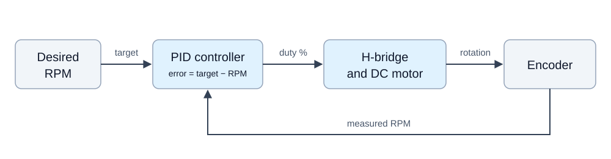

# Lab 10 DC Motor Drivers Encoders and PID Control

In this lab, you will drive a DC motor with an H-bridge, measure its speed with an encoder, and tune a PID controller to maintain a target RPM under changing load.



## Objectives

- Control motor direction and PWM duty cycle.
- Convert encoder pulses to RPM.
- Implement and tune P, PI, and PID control.
- Measure tracking performance and disturbance recovery.

## Materials

- Arduino Nano ESP32 running CircuitPython, USB cable, and Mu or VS Code
- Breadboard, jumper wires, and button
- TB6612 motor driver
- DC gearmotor and slotted encoder disc
- T-slot interrupter with cable and a 10 kΩ pullup resistor

## Deliverables

- Forward/reverse drive and a working stop button.
- Verified encoder counts per revolution and RPM measurement.
- A tuned controller that reaches three positive RPM targets in your measured operating range. Aim for a final mean RPM within 10% of each target.

## Extensions
- Compare starting duty and RPM at different PWM frequencies.
- Add a timed, nonblocking startup boost, triggered only when starting from rest (a "kickstart").
- Use a potentiometer or accelerometer to command RPM within the measured range.
- Develop an automatic tuning procedure.

## Instructions

### Step 1 Wire the H-bridge

1. Connect your Nano and open your editor. Reuse your earlier PWM, button, and timer code.
2. Disconnect power and wire motor channel A using the [driver pinout](https://learn.adafruit.com/adafruit-tb6612-h-bridge-dc-stepper-motor-driver-breakout/pinouts). Connect `VCC` to `3V3`, `VM` to `3V3`, and all grounds together. Choose GPIOs for `AIN1`, `AIN2`, `PWMA`, and `STBY`; reserve `D2` for the encoder and `D7` for the button. Note: normally it would NOT be a good idea to connect the VM to the board's regulated 3.3V pin, but your Arduino Nano ESP32 has a 1A maximum current on it. 
3. Write `setMotor(motorNum, dutyPercent)`, accepting `"A"` and −100 to +100. Clamp the command, use its sign for direction, and convert its magnitude to PWM units:

   ```python
   pwm_value = round(abs(dutyPercent) * 65535 / 100)
   ```

   Use the [TB6612 truth table](https://cdn-shop.adafruit.com/datasheets/TB6612FNG_datasheet_en_20121101.pdf):

   | Action | `STBY` | `AIN1` | `AIN2` | `PWMA` |
   | --- | --- | --- | --- | --- |
   | Forward | High | High | Low | PWM |
   | Reverse | High | Low | High | PWM |
   | Coast | Low | Either | Either | Either |

   For zero duty, set PWM to zero and `STBY` low. For nonzero duty, set direction and PWM before enabling `STBY`. Note that PWM's off phase brakes the motor when `STBY` remains high; standby lets it coast.
4. Wire a button from `D7` to ground with an internal pullup. Check it every loop iteration. A press must disable drive and latch the program stopped until an explicit restart. Initialize with drive disabled and disable it on program exit, including exceptions.
5. Secure the motor, reconnect power, and test positive duty, zero, and negative duty. Let the wheel stop before reversing. Verify the button before continuing.

### Step 2 Characterize the motor

1. Start with PWM near 1 kHz and keep that frequency fixed.
2. Find the minimum duty that reliably starts the motor from rest.
3. Start it at a higher duty, then reduce duty. Find the lowest value that sustains rotation. Why are these values different?
4. (OPTIONAL, BUT ENCOURAGED) Write code that "kickstarts" your motor by momentarily applying a high enough duty cycle to get it started, then lowering down to the setpoint, if the setpoint is below the minimum duty you found in Step 2.2.

### Step 3 Measure RPM

1. Disconnect power. Mount the disc and wheel, and align the interrupter without rubbing.
2. Wire the [supplied T-slot sensor](https://www.adafruit.com/product/3985) as follows; check the pinout if your model differs:

   | Wire | Connection |
   | --- | --- |
   | Brown | `VBUS`, 5 V with USB connected |
   | Pink | Same supply as brown |
   | Blue | Common ground |
   | Black | `D2`, with 10 kΩ pullup to **3.3 V** |

3. With motor power off, read the input while turning the disc by hand. What happens over a slot? Over a blocked section?
4. Count falling edges using [`countio.Counter`](https://docs.circuitpython.org/en/9.2.x/shared-bindings/countio/). Release any previous input object on that pin first.

   ```python
   import board
   import countio
   encoder = countio.Counter(board.D2, edge=countio.Edge.FALL)
   ```

5. Count the slots; expect 20. Rotate the wheel exactly once and verify the count difference. Define `COUNTS_PER_REV` as counts per **wheel** revolution, including any gearing. Counting both edges would double this number.
6. Reconnect power. Initialize a count/time snapshot before the first measurement interval. At each update, calculate:

   ```text
   dt = time_now - time_previous
   delta_count = count_now - count_previous
   rpm = 60 * delta_count / (COUNTS_PER_REV * dt)
   ```

   Use actual elapsed seconds, require `dt > 0`, and save the current count/time for the next update. Do not reset the counter between samples.
7. Choose a measurement interval. With 20 counts/revolution, one count represents 30 RPM over 0.1 s, or 6 RPM over 0.5 s. Short windows give coarse measurements; long windows delay feedback. Resolve your target speeds while retaining enough samples to see the motor's acceleration.

**This single encoder channel cannot detect direction. Use forward rotation and nonnegative RPM targets for the feedback experiments.**

### Step 4 Record an open-loop baseline

1. Measure steady RPM at three to five forward duty settings, from reliable starting duty to about 80%. Record supply voltage and PWM frequency.
2. Choose low, medium, and high RPM targets within this range. Leave some duty available for correcting load changes.
3. At the medium target, choose a fixed duty that approximately produces the desired RPM. Include an initial sample at rest and mark the command step. Record for 8–10 seconds; extend the run if needed.
4. Schedule measurements with `time.monotonic()`. Keep checking the stop button between updates; do not wait with `sleep()`. Save `(time, target_rpm, measured_rpm, applied_duty)` at each update. Disable drive before printing the data.
5. Plot RPM and target against recorded time. For a quick Mu plot, replay `print((rpm, target))` after the run. Use timestamps for quantitative measurements.

### Step 5 Implement PID

Keep the interfaces separate:

```text
pid_update(target_rpm, rpm, dt) -> duty_percent
setMotor("A", duty_percent)    -> driver outputs
```

1. Update PID once per **new RPM measurement**, using the elapsed seconds between updates. Keep this interval reasonably consistent. Store controller state between calls; reset it before each trial.
2. Use the following discrete update, with nonnegative gains. `I` is the integral contribution in duty percentage, initially zero; initialize `rpm_previous` to the initial measured RPM.

   ```python
   error = target_rpm - rpm
   P = Kp * error
   I_trial = I + Ki * error * dt
   D = -Kd * (rpm - rpm_previous) / dt
   u_trial = u_ff + P + I_trial + D
   ```

   Choose `u_ff` from your open-loop measurements. Keep it fixed for a given target throughout the P/PI/PID comparison. It estimates the required duty; feedback corrects the error.
3. Prevent windup: accept `I_trial` only if `0 <= u_trial <= 100`, or if `u_trial > 100` and `error < 0`, or if `u_trial < 0` and `error > 0`. Otherwise retain `I`. Then recompute and limit the **total** command:

   ```python
   u = min(100, max(0, u_ff + P + I + D))
   rpm_previous = rpm
   ```

   Clipping duty alone does not prevent windup. Apply this rule as soon as you enable integral control.
4. **P:** Set `Ki = Kd = 0`. Increase `Kp` gradually. Estimate an initial gain from `additional_duty / initial_error`. Look for faster response without sustained oscillation; record steady error and overshoot.
5. **PI:** Add a small positive `Ki`. Does it remove persistent error? Reduce it if recovery becomes slow or oscillatory.
6. **PID:** Add a small positive `Kd`. The minus sign makes D oppose changes in measured speed. Using measurement rather than error avoids derivative kick when the target changes. D may reduce overshoot, but can amplify encoder noise. If commands become jerky, reduce D or low-pass filter its estimate and record the filter setting.
7. Compare all three at the same target. Implement and test D, but retain `Kd = 0` if your results favor PI. Use one final set of gains at all three targets; keep timing and filtering fixed.
8. For a zero target or button press, bypass PID, disable drive, and reset controller state. Preserve the button's stop latch. In forward control, a negative **total command** is clipped to zero; a negative feedback correction may simply reduce the feedforward duty.

If duty stays at 100%, check that the target is achievable. If RPM changes in large steps, improve the speed estimate before increasing gains.

### Step 6 Evaluate performance

1. For each final target, record a step from rest to positive RPM `r`. Measure times from the target step. Use these target-based definitions throughout:

   | Measurement | Definition |
   | --- | --- |
   | Rise time | Time from first crossing of `0.1*r` to first crossing of `0.9*r` |
   | Target overshoot | `100 * max(0, peak_rpm - r) / r` |
   | Settling time | First time after which all remaining samples stay within `[0.9*r, 1.1*r]`, with at least two seconds remaining |
   | Steady state error | `r - mean_rpm` over the final two seconds, provided speed is stable |

   Report missing crossings or settling as “not reached during run.” If still changing, label the final mean error as a final-window measurement. Do not claim precision finer than your sampling interval or encoder resolution.
2. Plot the representative P, PI, and PID trials and tabulate their measurements. Report the same measurements for your final controller at all three targets. Explain one tuning decision.
3. At the medium target, compare fixed duty with feedback under the **same light load**. Allow speed to settle, apply the instructor's load for a few seconds, then remove it. Record load timing, RPM, and duty. Keep the wheel turning and hands clear.
4. Compare speed drop, error under load, and recovery. Did feedback increase duty? Did saturation limit recovery? Explain why fixed duty can work well unloaded but fail when torque demand changes.


